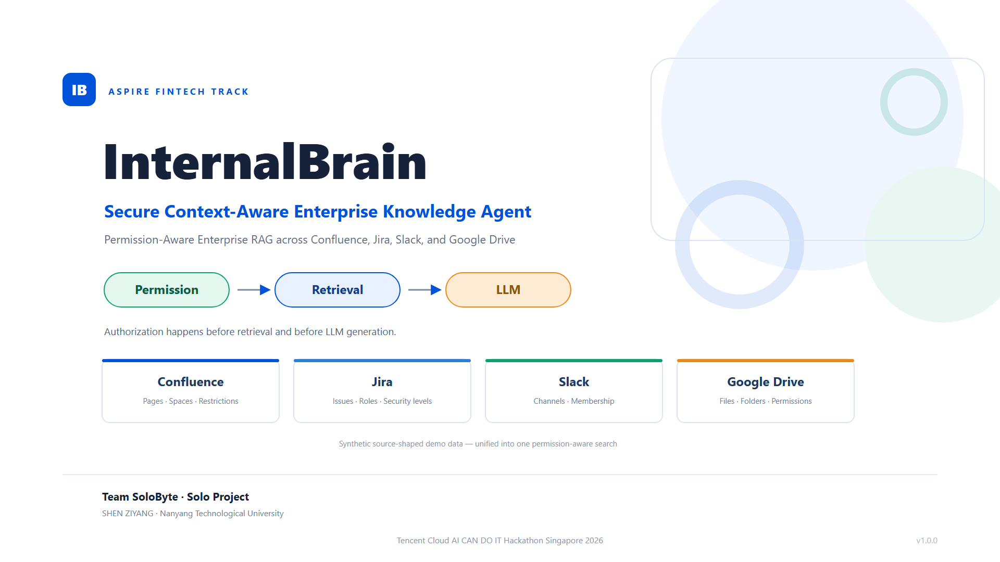
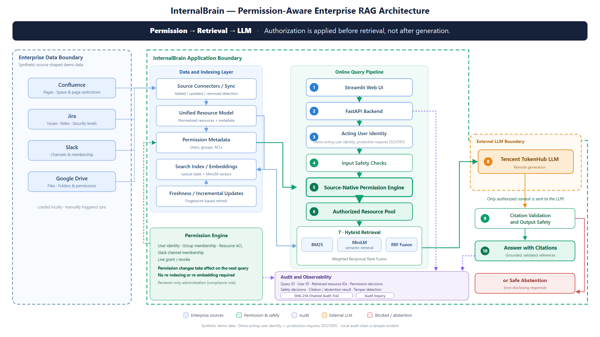
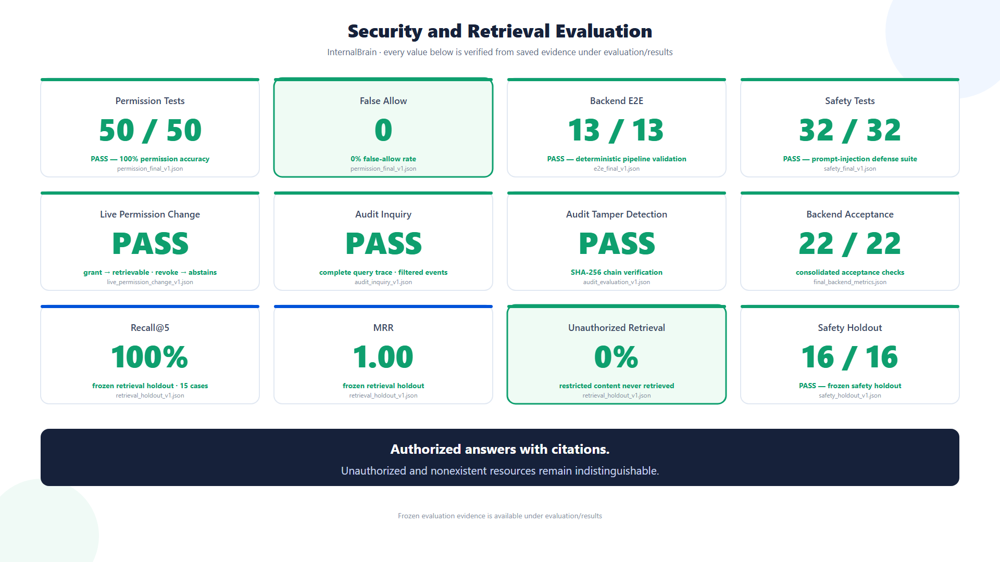

# InternalBrain

**Permission-Aware Enterprise RAG for secure, auditable knowledge access**

InternalBrain is a secure enterprise knowledge assistant built for the Tencent Cloud AI CAN DO IT Hackathon Singapore 2026. It provides one natural-language interface over synthetic enterprise data from Confluence, Jira, Slack, and Google Drive while enforcing source-native permissions before retrieval and before LLM generation.

> Core principle: unauthorized content never enters retrieval results, the LLM context, citations, or user-visible metadata.

## Why InternalBrain

Enterprise knowledge is fragmented across tools with different permission models. A conventional RAG pipeline often searches a global index first and filters later. Even if the final answer is filtered, restricted text or metadata may already have entered the retrieval pipeline or model prompt.

InternalBrain changes the order:

~~~text
User Identity
    -> Input Safety
    -> Query-Time Authorization
    -> Authorized Resource Pool Only
    -> Hybrid Retrieval
    -> Context Safety and Assembly
    -> Tencent TokenHub LLM
    -> Citation and Output Validation
    -> Audited Answer
~~~

Authorization is therefore part of retrieval itself, not a post-processing step.

## Key capabilities

| Capability | Implementation |
|---|---|
| Unified enterprise search | Confluence, Jira, Slack, and Google Drive |
| Source-native access control | Space, project, channel, folder, file, group, role, and user permissions |
| Query-time authorization | Permission checks occur before ranking and context assembly |
| Hybrid retrieval | BM25 plus MiniLM semantic retrieval with weighted reciprocal rank fusion |
| Grounded answers | The LLM receives only authorized, safety-checked context |
| Validated citations | Returned citations must refer to supplied authorized context |
| Safe abstention | Missing, irrelevant, and inaccessible content produces a non-disclosing response |
| Prompt-injection defense | Input, retrieved-content, and output safety stages |
| Live permission updates | Permission changes affect the next query without an explicit index rebuild |
| Tamper-evident audit | SHA-256 chained events plus filtered audit inquiry |
| Reviewer controls | Audit, synchronization, and permission management are restricted to the compliance role |

## Architecture

~~~mermaid
flowchart TB
    U[User / Acting Identity] --> UI[Streamlit UI]
    UI --> API[FastAPI]
    API --> IS[Input Safety Guard]
    IS --> ID[Identity Resolution]
    ID --> PE[Query-Time Permission Engine]

    subgraph Sources[Enterprise Sources - Synthetic Demo Data]
        C[Confluence]
        J[Jira]
        S[Slack]
        G[Google Drive]
    end

    C --> URM[Unified Resource Model]
    J --> URM
    S --> URM
    G --> URM
    URM --> PE

    PE -->|Authorized resources only| BM[BM25]
    PE -->|Authorized resources only| SEM[MiniLM Semantic Retrieval]
    BM --> RRF[Weighted Reciprocal Rank Fusion]
    SEM --> RRF
    RRF --> CS[Retrieved-Content Safety]
    CS --> CA[Context and Citation Assembly]
    CA --> LLM[Tencent TokenHub LLM]
    LLM --> CV[Citation Validation]
    CV --> OS[Output Safety]
    OS --> A[Grounded Answer or Safe Abstention]
    A --> UI

    API -. events .-> AUD[SHA-256 Chained Audit Trail]
    PE -. decisions .-> AUD
    LLM -. generation .-> AUD
    OS -. result .-> AUD

    PS[Permission Store] --> PE
    PC[Reviewer Permission Change] --> PS
    PC -. no explicit index rebuild .-> PE
~~~

The detailed architecture, trust boundaries, and control flows are documented in [docs/architecture.md](docs/architecture.md).

## Security model

### Authorization before retrieval

For every query, InternalBrain resolves the acting user and evaluates the current permission state for every candidate resource. Only authorized resources are provided to BM25 and semantic retrieval. Restricted content therefore cannot reach ranking, context assembly, the remote LLM, citations, or the response.

### Non-disclosing denial behavior

An inaccessible resource and a nonexistent resource intentionally produce the same user-visible response:

~~~text
I could not find enough information to answer this question.
~~~

No restricted filename, resource ID, permission decision, or existence signal is exposed.

### Safety stages

1. **Input safety** blocks direct prompt-injection and credential-extraction requests before retrieval or LLM use.
2. **Retrieved-content safety** blocks malicious instructions embedded in enterprise content.
3. **Citation validation** verifies that citations refer to supplied context.
4. **Output safety** detects potential secret leakage or unsafe generated output.
5. **Safe abstention** returns a consistent response when evidence is missing or insufficient.

### Reviewer-only administration

Audit inquiry, synchronization, permission reload, and live permission management require a user with the compliance-officer role. Both the Streamlit UI and FastAPI endpoints enforce this restriction.

The current identity transport uses the X-InternalBrain-Actor request header for the hackathon demo. It demonstrates role enforcement but is not a production authentication mechanism. A production deployment should replace it with verified SSO/OIDC identity and signed service-to-service credentials.

## Live permission changes

The demo can revoke or grant David (u004) access to the private Slack channel C-PAY:

~~~text
Revoke -> query safely abstains
Grant  -> C-PAY becomes retrievable on the next query
Revoke -> query safely abstains again
~~~

The searchable resource count remains unchanged because permissions are evaluated at query time. No explicit index rebuild is triggered by a permission change; the updated authorization state is applied to the next query. Every change records the reviewer, target user, resource, action, result, and audit event ID.

## Auditability

Every query produces a trace of security-relevant events, including:

- query receipt;
- input-safety decision;
- authorization-aware retrieval;
- retrieved-content safety;
- context assembly;
- LLM generation;
- citation validation;
- output safety; and
- final response.

Audit records form a SHA-256 hash chain. The reviewer interface can verify chain integrity and filter events by query ID, user ID, event type, action, and resource ID.

## Evaluation results

The committed evidence is under [evaluation/results](evaluation/results). The consolidated acceptance report is [final_backend_metrics.json](evaluation/results/final_backend_metrics.json).

| Evaluation | Result |
|---|---:|
| Searchable resources | **88** |
| Enterprise sources | **4** |
| Final backend acceptance | **22/22 PASS** |
| Permission tests | **50/50 PASS** |
| Permission accuracy | **100%** |
| False allow rate | **0%** |
| Frozen retrieval holdout | **15 cases** |
| Recall@5 | **100%** |
| Hit@5 | **100%** |
| MRR | **1.00** |
| Unauthorized retrieval rate | **0%** |
| Frozen negative-case accuracy | **75% (3/4)** |
| Safety regression suite | **32/32 PASS** |
| Frozen safety holdout | **16/16 PASS** |
| Backend E2E | **13/13 PASS** |
| Live permission change | **PASS** |
| Permission propagation success | **100%** |
| Audit trace completeness | **100%** |
| Audit tamper detection | **PASS** |

### Measured latency

These are retained benchmark results, not live monitoring values:

| Measurement | Result |
|---|---:|
| Authorization p95 | **0.30 ms** |
| Permission grant-to-retrievable p95 | **447 ms** |
| Hybrid retrieval p95 | **940 ms** |
| Backend pipeline p95, excluding remote LLM | **1.09 s** |
| Tencent TokenHub E2E p50 | **6.86 s** |
| Tencent TokenHub E2E p95 | **9.79 s** |
| Audit inquiry p95, latest local run | **1.36 ms** |

The backend pipeline benchmark uses a deterministic test double for reproducibility and excludes remote LLM inference. The TokenHub figures were measured separately over 10 successful remote requests. Latency varies with hardware, network conditions, model service load, and cache state.

The frozen retrieval holdout achieved 100% Recall@5 and zero unauthorized retrieval. Negative-case accuracy was 75% across four cases: one query returned authorized but insufficiently relevant content. This was not an unauthorized retrieval.

## Quick start

### Prerequisites

- Windows PowerShell or a compatible shell
- Python 3.12 recommended
- A Tencent TokenHub API key for real generated answers

### 1. Create an environment

~~~powershell
py -3.12 -m venv .venv
. .\.venv\Scripts\Activate.ps1

python -m pip install --upgrade pip
python -m pip install -r requirements.txt
~~~

For development and automated tests:

~~~powershell
python -m pip install -r requirements-dev.txt
~~~

### 2. Configure TokenHub

~~~powershell
Copy-Item .env.example .env
notepad .env
~~~

Set:

~~~env
TOKENHUB_API_KEY=your_api_key_here
LLM_BASE_URL=https://tokenhub-intl.tencentmaas.com/v1
LLM_MODEL=hy3
~~~

Never commit the .env file or a real API key.

### 3. Start the backend

~~~powershell
python -m uvicorn app.api.main:app --host 127.0.0.1 --port 8000
~~~

Health check:

~~~powershell
Invoke-RestMethod http://127.0.0.1:8000/health | ConvertTo-Json
~~~

Expected service version: **1.0.0**. Expected resource count: **88**.

### 4. Start the frontend

Open a second PowerShell in the project root:

~~~powershell
$env:INTERNALBRAIN_API_URL = 'http://127.0.0.1:8000'
python -m streamlit run frontend/app.py
~~~

## Demo users

| User | Role | Purpose in the demo |
|---|---|---|
| u001 - Alice Chen | Backend Engineer | Authorized cross-source knowledge query |
| u004 - David Okafor | Finance Manager | Live C-PAY permission-change target |
| u005 - Elena Petrova | Compliance Officer | Reviewer-only audit, sync, and permission controls |
| u007 - Grace Kim | Contractor | Non-disclosing restricted/missing-resource behavior |

The demonstration flow covers authorized retrieval, non-disclosing abstention,
live permission changes, safety enforcement, and audit inquiry.

## API summary

| Method | Endpoint | Purpose |
|---|---|---|
| GET | /health | Service status, version, and resource count |
| POST | /query | Permission-aware question answering |
| POST | /sync | Resource or full synchronization; reviewer only |
| POST | /permissions/reload | Reload permissions; reviewer only |
| GET | /demo/permissions/slack/{channel_id}/users/{user_id} | Inspect demo permission; reviewer only |
| POST | /demo/permissions/slack/membership | Grant or revoke demo membership; reviewer only |
| GET | /audit/verify | Verify the audit hash chain |
| GET | /audit/events | Filtered audit inquiry; reviewer only |

Interactive API documentation is available at http://127.0.0.1:8000/docs while the backend is running.

## Testing

Core repository checks:

~~~powershell
python -m unittest tests.test_access_indistinguishability -v
python -m unittest tests.test_admin_authorization -v
python tests/frontend/test_frontend.py
python tests/frontend/test_frontend_live.py
python -m unittest tests.frontend.test_api_client -v
python tests/validate_dataset.py
python -m evaluation.test_live_permission_change
python -m evaluation.test_audit_inquiry
~~~

Additional evaluation programs and frozen cases are under [evaluation](evaluation). Frontend manual acceptance steps are documented in [FRONTEND_TESTING_GUIDE.md](FRONTEND_TESTING_GUIDE.md).

## Project structure

~~~text
internalbrain/
|-- app/
|   |-- api/          FastAPI endpoints and schemas
|   |-- auth/         Permission store and authorization engine
|   |-- connectors/   Source-specific resource adapters
|   |-- data/         Dataset loading
|   |-- llm/          Prompting, TokenHub client, answer and citation logic
|   |-- retrieval/    BM25, MiniLM, fusion, and context assembly
|   |-- security/     Safety guards and chained audit services
|   `-- sync/         Resource and permission refresh
|-- data/             Synthetic enterprise data and permissions
|-- frontend/         Streamlit application and HTTP client
|-- tests/            Authorization, frontend, and dataset tests
|-- evaluation/       Evaluation suites, frozen cases, and result evidence
|-- docs/             Architecture and presentation assets
|-- .env.example
|-- requirements.txt
`-- README.md
~~~

## Scope and limitations

- All included enterprise records and identities are synthetic demo data.
- Connectors read the bundled source-shaped datasets; production connector authentication, webhooks, and rate-limit handling are outside this prototype.
- Content synchronization is manually triggered and uses fingerprint-based added/updated/removed detection.
- Permission updates are enforced at query time after InternalBrain receives the change; no explicit index rebuild is triggered. The prototype does not claim source-platform webhook or connector propagation latency.
- Demo identity is supplied by an application header and must be replaced by verified enterprise authentication in production.
- Audit chaining is tamper-evident, not an external immutable ledger.
- The prototype performs in-memory authorization filtering and retrieval over 88 searchable resources. A production-scale deployment would use ACL-aware indexed retrieval, precomputed embeddings, and an enterprise search or vector-store backend rather than rebuilding retrieval state per request.
- Benchmark results describe the recorded test environment and are not production SLA guarantees.

## Submission material

- [Architecture and trust boundaries](docs/architecture.md)
- [Architecture diagram](docs/images/02-internalbrain-architecture.png)
- [Security and retrieval evaluation](docs/images/03-internalbrain-results.png)
- [Frozen evaluation evidence](evaluation/results)
- [Consolidated backend metrics](evaluation/results/final_backend_metrics.json)

## Release

Submission release: **InternalBrain v1.0.0**  
Recommended Git tag: **v1.0-submission**

